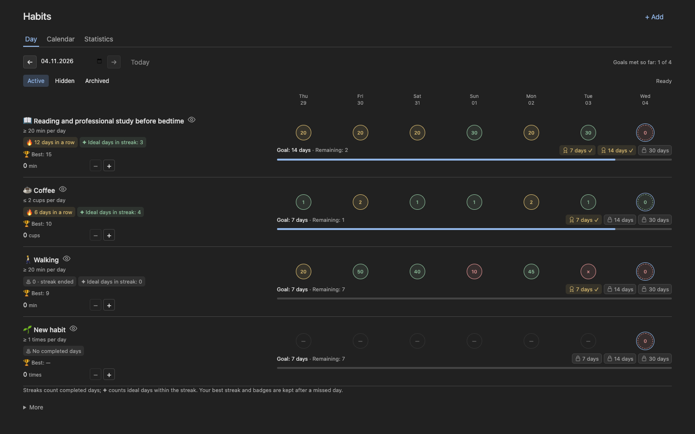

# Habits for Super Productivity

Track habits, build routines and keep unwanted habits within limits — inside [Super Productivity](https://super-productivity.com/).

Set a goal such as reading for 20 minutes a day, limit coffee to two cups, or aim for three workouts over seven days. Record your progress and see your history in one place.

Current release: **0.25.0** · Requires **Super Productivity 19.3.1+** · [Download](https://github.com/KingKord/sp-habits/releases/latest) · [User guide](docs/user-guide.md)



*Demo habits with synthetic data.*

## What you can do

- **Build or limit a habit.** Use daily or rolling goals/limits, or positive calendar-week goals for quantities or distinct successful days.
- **Choose how to track.** Select Done/Missed or a standard/custom quantity unit from one Tracking field. Add an optional time condition to a daily check-in.
- **See your progress.** Browse daily history, a monthly calendar, statistics, streaks, personal bests and a focused habit detail view.
- **Adjust over time.** Change a goal from a chosen date or plan gradual reductions while keeping past rules.
- **Choose due days and breaks.** Use selected weekdays or anchored intervals, plus dated pauses and exceptions.
- **Choose what Day shows.** Use Hidden to show or hide hidden habits alongside ordinary habits; archives stay separate.
- **Organize your routine.** Drag habits by their handles or use keyboard controls, add named groups, collapse several groups to focus on the one you need, and record optional daily notes.
- **Link recurring tasks.** Count completions from supported fixed daily and weekly schedules in Super Productivity.
- **Keep your history.** Hide or archive a habit, correct past entries, and export or import JSON backups.

English and Russian, light and dark themes, and layouts for narrow and wide screens are included. Habits needs no separate account or server and makes no runtime network requests.

## Install

1. Download **`sp-habits.zip`** from the [latest release](https://github.com/KingKord/sp-habits/releases/latest). Use the release asset, not GitHub's source-code ZIP.
2. In Super Productivity, open **Settings → Plugins → Choose Plugin File**.
3. Select the ZIP without extracting it and confirm installation.
4. Make sure **Habits** is enabled, then open it from the sidebar.

Plugins run inside Super Productivity and can access app data. Install builds you trust. Each release also provides a SHA-256 file if you want to check the download.

### Updating

First use **More → Export JSON** to save a backup. Upload the new ZIP through the same settings screen, without removing the installed plugin. Habits keeps a stable plugin ID so compatible updates can reuse saved history and JSON backups. Reload Super Productivity after installing an update so it loads the new plugin code. See the [verification log](VERIFICATION.md) for checked versions and platforms.

## Try your first habit

1. Select **Add habit** and enter a name.
2. Choose **Good** to build a habit or **Bad** to limit or avoid it.
3. In **Tracking**, choose **Done / missed** or a quantity unit. For quantities, set the amount and period; for check-ins, optionally add a **No later than** time. Set the start date and save.
4. Use the result buttons for a check-in or **+ / −** for quantities. Select a past day to correct it. Expand a row with its chevron to see recent history, notes and additional actions.
5. Select **Reorder**, then drag a handle to move a habit within its group. Up/Down arrow keys on the handle and the **⋯** menu are alternatives. Select **Done reordering** to finish. Use **Manage groups** separately to organize groups.

With focus inside Habits, your configured app-wide **Add task** shortcut (normally **Shift+A**) opens a new habit. The host header **+** and the system-wide desktop shortcut continue to create tasks.

For example, choose Good, 20 min per day and a step of 5 for reading. Each **+** adds five minutes. For coffee, choose Bad and two cups per day: two is within the allowance, three is over it.

For a daily check-in, such as getting up no later than 08:00, confirm the outcome with Done/Missed (or No slip/Slipped for a bad habit). You can enter the result later; the click time does not determine it. Repeating the selected action clears the mark. Unmarked days stay unknown.

Today's result is provisional. Streaks and success percentages use completed tracked days. A period of seven days means a rolling window, rather than a calendar week.

For optional review tasks, reduction plans, colour settings and full task-link behavior, see the [user guide](docs/user-guide.md).

## Your data and current limits

Habits stores its history through Super Productivity's plugin storage. Names, custom units and existing history are preserved in their original language. It does not send your data to a separate service; cross-device sync depends on your Super Productivity settings.

Export before importing: an import replaces the complete plugin history after confirmation. Wait for saving to finish before closing after an edit. If a write fails, use **Reload data** to return to confirmed storage.

The project is actively evolving. Keep these limits in mind:

- Linked tasks support active, fixed `DAILY` and `WEEKLY` schedules with intervals of 1–366. Monthly, yearly and after-completion schedules remain unsupported.
- Counts are whole numbers. Days run from midnight to midnight in the saved timezone.
- Concurrent editing on multiple devices is unsupported. Serial delivery was verified with local WebDAV; metadata sometimes needed a second completed sync cycle.
- Physical mobile devices and Safari remain unverified. Chromium checks include host 20.0.0 and official 19.3.1 embedded web assets served locally; see the verification log for exact limits.

Read the [full rules and limitations](docs/user-guide.md) before relying on a particular workflow.

## Help and contributions

For a bug or a feature idea, [open an issue](https://github.com/KingKord/sp-habits/issues/new/choose). Include the Habits version, Super Productivity version and steps to reproduce. Use invented examples instead of uploading personal habit backups.

Code, documentation, translations and reproducible bug reports are welcome. Start with [CONTRIBUTING.md](CONTRIBUTING.md); it explains setup, checks and the pull request process. Community participation follows the [code of conduct](CODE_OF_CONDUCT.md). For vulnerabilities, use the [security policy](SECURITY.md).

## Build from source

Use Node.js 24 LTS, `zip` and `unzip`:

```sh
git clone https://github.com/KingKord/sp-habits.git
cd sp-habits
npm ci
npm run check
```

Install `dist/sp-habits.zip` in a separate test profile. See [development](docs/development.md) for the architecture and testing guidance, or the [release guide](docs/releasing.md) for publication.

## License

Habits code is available under the [MIT License](LICENSE). Bundled Unicode emoji and CLDR data retain their [separate license and notices](THIRD_PARTY_LICENSES.txt).

This is a community plugin, maintained independently of the Super Productivity project.
